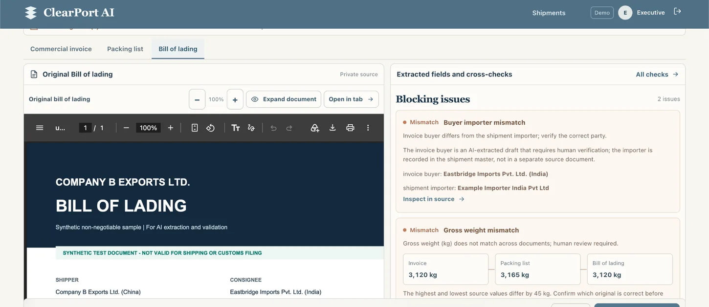
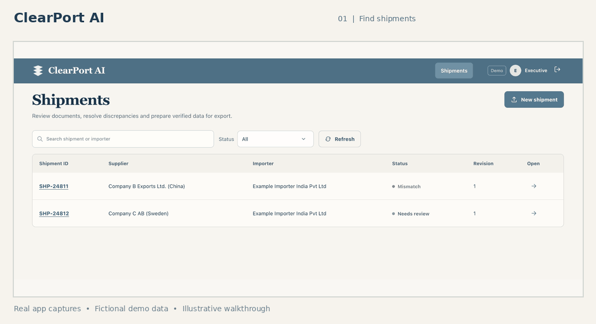
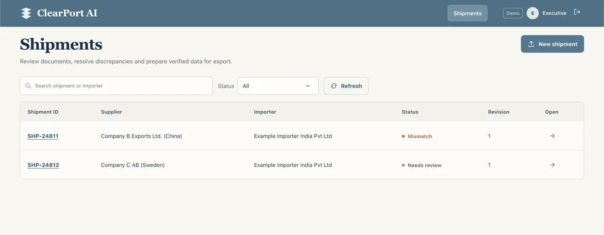
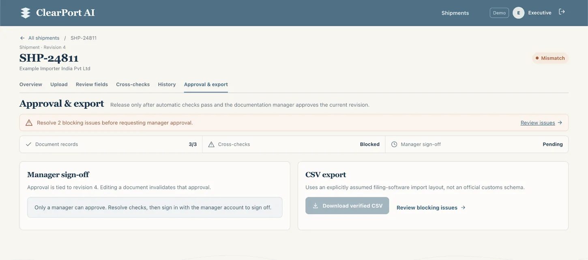
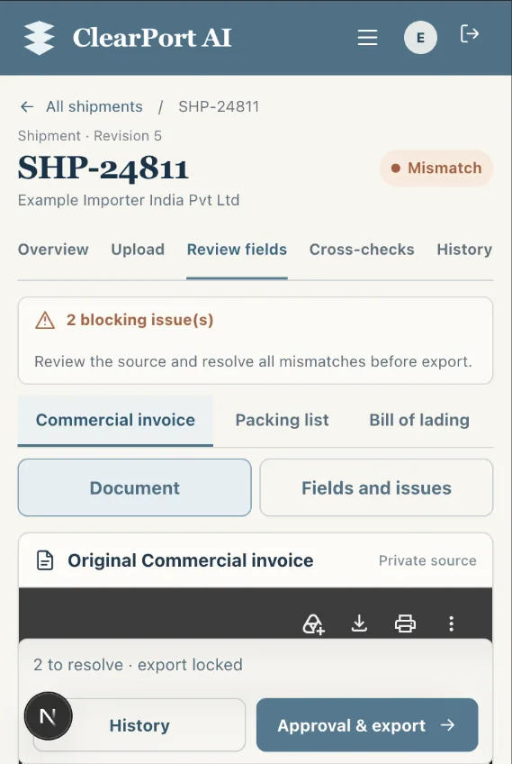
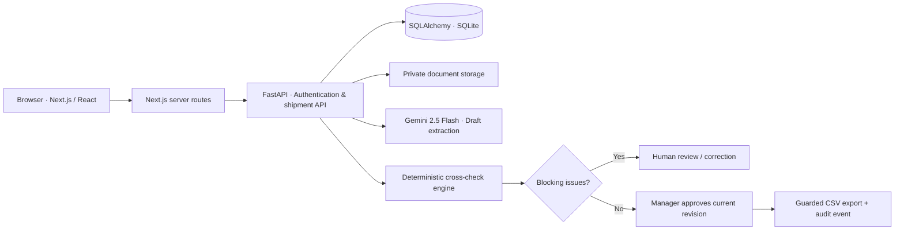

<div align="center">

# ClearPort AI — Intelligent Customs Document Review

**Intelligent customs document review, from source evidence to controlled export.**

A full-stack workspace for extracting structured data from shipping documents, detecting cross-document discrepancies, and keeping humans in control of every approval.

**[Open live demo](https://friendly-truth-production.up.railway.app)** · **[Explore the code](https://github.com/ssriii07/clearport-ai)** · [Getting started](#getting-started) · [Architecture](#architecture)

</div>



<p align="center"><sub>Real capture from the deployed application · All company names and document details shown are fictional.</sub></p>

## Overview

Customs teams work across a **Commercial Invoice**, **Packing List**, and **Bill of Lading**. Re-entering their details and spotting disagreements manually takes time—and an AI-generated value is not trustworthy simply because it looks confident.

ClearPort AI connects the original documents to an editable extraction draft, runs transparent deterministic checks, and **blocks CSV export until the checks clear and a manager approves the current revision**.

## See it in action



<sub>This is a timed slideshow of real application screenshots, not a simulated AI processing video.</sub>

## Explore the interface

<table>
<tr>
<td width="50%" valign="top">
<strong>01 · Shipment workspace</strong><br/>
Find a shipment, filter by status, and see what needs review.<br/><br/>

</td>
<td width="50%" valign="top">
<strong>02 · Evidence-first document review</strong><br/>
Inspect original PDFs beside extracted fields and the exact blocking issues.<br/><br/>

</td>
</tr>
<tr>
<td width="50%" valign="top">
<strong>03 · Approval and guarded export</strong><br/>
Automatic checks and manager sign-off are separate gates; blocked exports explain why.<br/><br/>

</td>
<td width="50%" valign="top">
<strong>04 · Responsive review</strong><br/>
A narrower mobile layout keeps shipment navigation and document/field views accessible.<br/><br/>
<div align="center"></div>
</td>
</tr>
</table>

## Features

| Capability | Implementation |
| --- | --- |
| **Vision extraction** | Sends PDF, PNG, and JPEG document content to Gemini 2.5 Flash from the FastAPI server and stores editable *draft* fields. |
| **Human verification** | Original document preview, per-field review/edit actions, source highlighting for searchable PDFs, correction reasons, and manual-entry fallback. |
| **Deterministic validation** | Checks invoice arithmetic, package counts, gross weights, required information, invoice references, and invoice buyer versus the shipment importer. |
| **Uncertainty handling** | Model-supplied scores are **uncalibrated self-estimates**, not measured extraction accuracy. Low/invalid confidence requires human confirmation. |
| **Controlled decisions** | Executive/Manager roles, revision-specific manager sign-off, export blocked on outstanding issues, and CSV formula-injection protection. |
| **Traceability** | Audit events for field changes, confirmations, source access, approvals, and CSV exports. |

### A deliberate discrepancy

The fictional sample shipment `SHP-24811` contains a **45 kg difference** between the packing list and the other documents:

| Source | Gross weight |
| --- | ---: |
| Commercial Invoice | 3,120 kg |
| Packing List | **3,165 kg** |
| Bill of Lading | 3,120 kg |

The sample also shows a **buyer/importer identity mismatch**, an additional validation rule introduced as a design assumption. Neither conflict is silently “corrected” to make export pass.

`SHP-24812` demonstrates a different case: seeded documents pass automatic cross-checks but **still require manager sign-off**. Its initial seeded records do **not** have original PDFs attached; passing checks alone must not be described as source verification.

## Architecture



The frontend and backend are separate services in the same Railway project. They communicate through Railway's private service network; the browser uses the public Next.js URL. The demonstration SQLite database and uploaded files live on the backend's persistent volume.

**Stack:** Next.js 15 · React 19 · TypeScript · FastAPI · Python · SQLAlchemy · SQLite · Google Gemini · PyMuPDF · Railway

## Getting Started

**Prerequisites:** Python 3.12+, Node.js compatible with Next.js 15, npm, and (for live AI extraction) a Gemini API key.

**1. Clone and start the backend**

```bash
git clone https://github.com/ssriii07/clearport-ai.git
cd clearport-ai
python3 -m venv .venv
source .venv/bin/activate
cd backend
python -m pip install -r requirements.txt
python -m clearport.seed_db
python -m pytest -q
python -m uvicorn clearport.api:app --reload
```

The API runs at `http://127.0.0.1:8000` (interactive API docs: `/docs`). The seed command creates a local SQLite database and fictional demo accounts. To enable **new AI extractions**, set `GEMINI_API_KEY` in the backend process environment before starting Uvicorn; optionally set `GEMINI_MODEL=gemini-2.5-flash`. **Never commit API keys.**

**2. Start the frontend in another terminal**

```bash
cd clearport-ai/frontend  # in a new terminal, from the directory where you cloned the repo
cp .env.example .env.local
npm ci
npm run dev
```

Open `http://127.0.0.1:3000`. In `frontend/.env.local`, `BACKEND_URL` should point to the local API and `CLEARPORT_APP_ORIGIN` should match the browser's origin. If you're already inside `clearport-ai/backend`, use `cd ../frontend` instead of the first line above.

<details>
<summary><strong>Fictional demo accounts</strong></summary>

| Role | Email | Password |
| --- | --- | --- |
| Executive | `executive@clearport.demo` | `DemoExec#2026` |
| Manager | `manager@clearport.demo` | `DemoManager#2026` |

These are shared **demo-only** accounts, not production credentials. Do not upload genuine client, personal, or commercial documents.

</details>

## Testing

The latest reported local backend run completed **48 tests passed** (`python -m pytest -q`). Coverage includes cross-document arithmetic, bad/missing values, confidence boundaries, source access, authentication, role enforcement, stale revisions, approval invalidation, blocked exports, and CSV injection protection. The frontend also passed TypeScript checking and a production build during the final review.

The product intentionally fails closed: unresolved issues prevent export, replacing or changing a document invalidates prior approval, and extraction errors must not silently overwrite a valid previous draft. Human confirmation is recorded separately from the AI's original self-score.

## Limitations

This is a **fictional-data technical demonstration**, not a production customs filing service:

- The CSV follows an **assumed import layout**. No actual filing-software schema or customs-portal integration was supplied.
- The buyer/importer check, confidence cutoff, and several sample data fields are documented **design assumptions**, not claimed client requirements.
- Self-reported model confidence is not calibrated accuracy; no 95% extraction-accuracy claim has been validated against historical shipments.
- The Railway demo is **not hosted in India** and has not been certified for confidential client-data residency or a no-training AI processing contract. Use synthetic documents only.
- Production hardening remains necessary: managed identity, rate limiting, formal migrations, encrypted object storage, retention/deletion controls, concurrency handling, and security review.
- Out of scope: customs portal filing, duty/HSN classification, and customer-facing shipment tracking.

For further design context, see [`docs/ASSUMPTIONS.md`](docs/ASSUMPTIONS.md), [`docs/ARCHITECTURE.md`](docs/ARCHITECTURE.md), and [`docs/REQUIREMENTS.md`](docs/REQUIREMENTS.md). Some of those files preserve the original planning baseline; **this README describes the implemented demonstration**.

---

<sub>Built as a software engineering take-home assessment for Isocode Labs. All screenshots show fictional data from the working ClearPort AI application.</sub>
